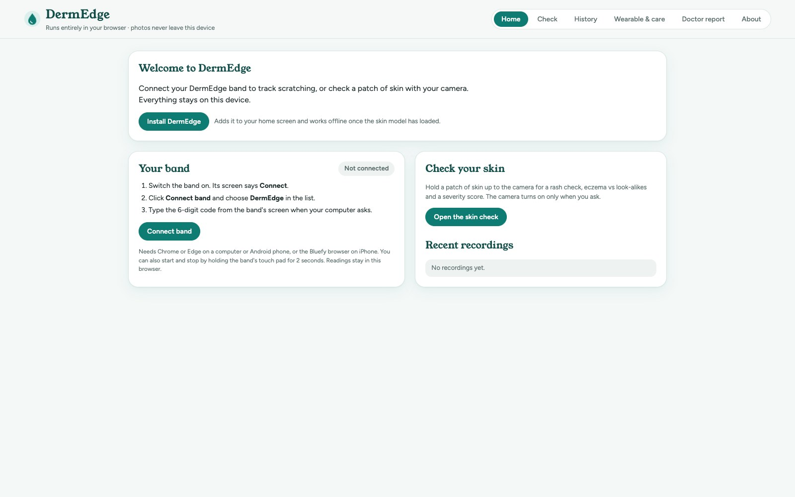
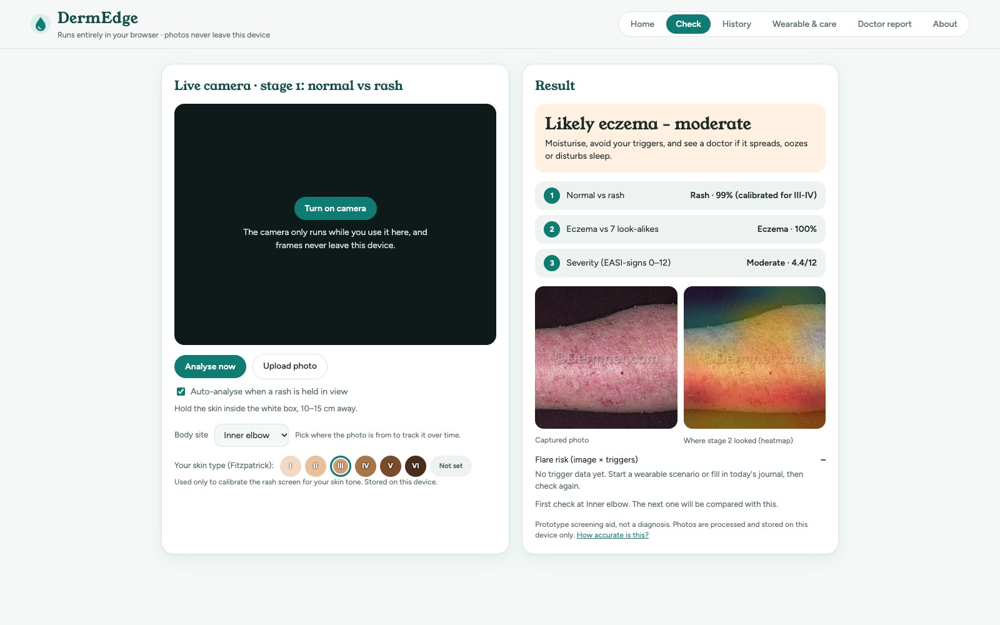
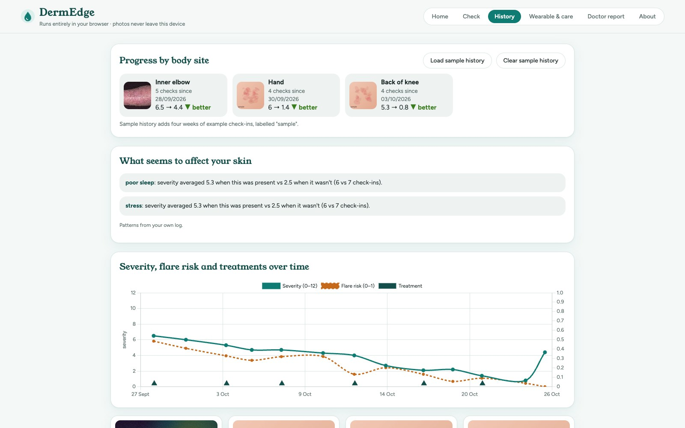
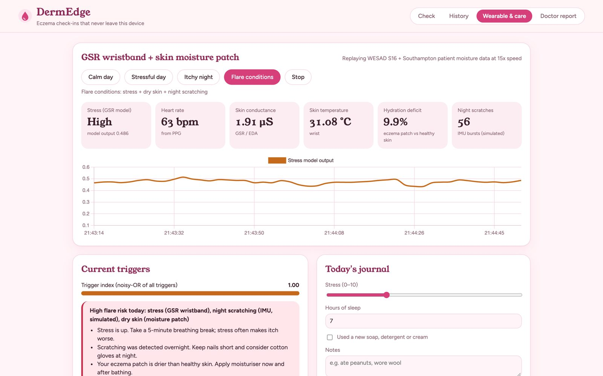
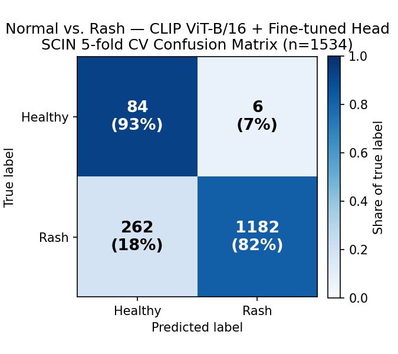
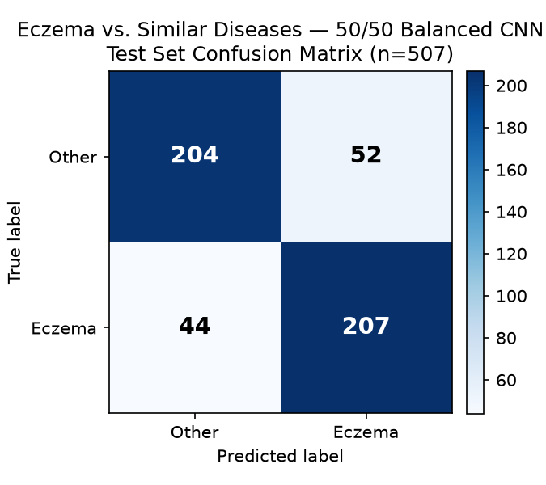
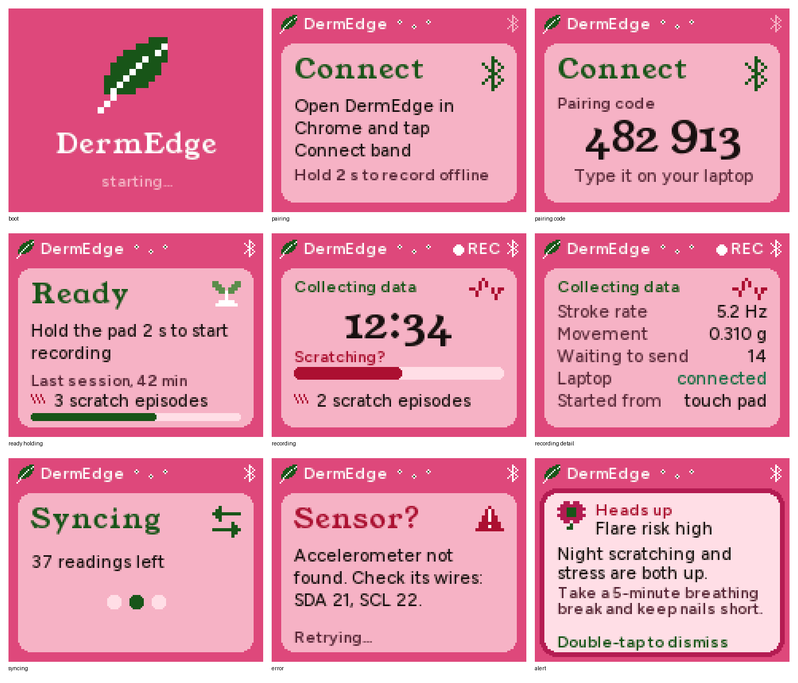

# DermEdge

**Private eczema screening and flare tracking: a camera, a wearable, and AI that runs on your own device. No cloud; photos never leave the device.**

DermEdge checks a photo of skin in three stages, tracks each body site over time, and combines the result with wearable stress and skin-moisture markers into a daily flare-risk score with tips. It runs on a laptop hub or entirely in the browser.

**Live demo: https://derm-edge.vercel.app** (runs on your device; the first visit downloads the skin model once).

**Pitch deck:** [Canva](https://canva.link/sjz2ti8lsuddh4j), with its slide text in [docs/PITCH_DECK.md](docs/PITCH_DECK.md).

Built by **Team DermEdge** (Tishya Yadlapalli, Nitish GB, Shreeya Jetti) for the **Telemedicon 2026 AI & Digital Health Hackathon**, IIIT Sri City.

| Home | Check |
|---|---|
|  |  |
| **History** | **Wearable & care** |
|  |  |

## How it works

```
Phone / laptop cam ─► [1] Normal vs rash ─► [2] Eczema vs 7 look-alikes ─► [3] Severity 0–12
                                                                               │
DermEdge band + GSR, moisture ─► scratching, stress, hydration ──────────► Flare risk + tips
                                                                               │
                                                     Dashboard: history, body sites, doctor report
```

| Part | Model | Runs on | Result |
|---|---|---|---|
| 1. Normal vs rash | CLIP ViT-B/16 + fine-tuned head | Laptop hub | **AUC 0.93** on held-out real phone photos (SCIN, 5-fold CV by case) |
| 2. Eczema vs look-alikes | ResNet18 | Laptop hub | **81.1% accuracy, 82.5% recall** (curated test split, 507 images) |
| 3. Severity | Ridge head on CLIP features, 0–12 EASI-signs score | Laptop hub | Mean error **1.2 points**; band within one step **97.6%** |
| Stress | LightGBM on GSR, skin temp, PPG, motion, calibrated per wearer | Laptop hub | **AUC 0.92–0.94** leave-one-person-out (WESAD) |
| *Future scope:* on-device screen | MobileNetV1-0.25 INT8, 300 KB | ESP32-CAM | **97.1%** accuracy on its test set |

Skin temperature is used only inside the stress model, not as an eczema signal. Plan, decisions and future scope: [docs/HARDWARE_PLAN.md](docs/HARDWARE_PLAN.md).

Stage 2 tells eczema apart from seven look-alikes: psoriasis, tinea, candidiasis, insect bites, lichen planus, drug eruption and rosacea.

| Stage 1: normal vs rash | Stage 2: eczema vs look-alikes |
|---|---|
|  |  |
| Real phone photos (SCIN), held out by case: 1182 of 1444 rashes caught, 84 of 90 healthy photos cleared. | Curated test split: of 251 eczema photos it caught 207 and missed 44; of 256 look-alikes it flagged 52 as eczema. |

### Fair across skin tones
At one shared threshold, the rash screen caught 84% of rashes on Fitzpatrick I–IV but only 67% on V–VI, even though it ranked them almost as well (AUC 0.91 vs 0.93). Choosing your skin type applies a calibrated threshold, which brings V–VI to **83%**. Details: `experiments/clip_rash_head/summary.json`.

## Features
- Live camera with a rash / no-rash badge, on only when you turn it on; auto-analyses when a rash is held in view
- Photo quality check: asks for a retake when the photo is blurry, too dark or washed out
- Grad-CAM heatmap of where the eczema model looked
- "Not sure, see a dermatologist" when the models disagree or are uncertain
- Body-site tracking with before/after comparison ("inner elbow 6.1 → 4.3, better")
- Wearable markers: stress, heart rate, skin conductance, skin temperature, hydration deficit, night scratching
- **DermEdge band**: connect it from the Home tab (Chrome or Edge, Web Bluetooth, a 6-digit pairing code); an ESP32 wristband that detects scratching from its accelerometer, starts and stops recordings from a touch pad or the app, keeps about 20 hours of readings in its flash while offline (they survive a restart), and shows flare alerts on its own screen
- Accounts and paired bands: recordings, scratch events and alerts stored on the hub behind a login, with encrypted, passkey-paired Bluetooth to the band
- Daily flare risk with alerts and one tip per active trigger
- Skin-type calibration (Fitzpatrick I–VI)
- Treatment log (moisturiser, steroid cream, antihistamine, wet wrap…) shown on the history chart
- Trigger insights: which of your triggers line up with worse check-ins, from your own log
- First-run setup: privacy consent, skin type and the body sites you want to track
- History chart, sample history for demos (clearly labelled), printable doctor report

## Try it in your browser
`web/` is a static version of the dashboard where every model runs on the visitor's own device: CLIP through transformers.js (WebGPU + fp16 where available, otherwise WebAssembly), the eczema-vs-look-alikes ResNet18 through ONNX Runtime Web, and the stress model in plain JavaScript. History is kept in the browser, nothing is uploaded, and the wearable tab uses a simulated wristband. The first visit downloads the skin model once (~175 MB with WebGPU). It's deployed on Vercel from this repo (`vercel.json`); to try it locally, serve `web/` with any static server.

Checked against the Python models: the browser CLIP gives the same stage-1 decision on 98.5% of 200 held-out phone photos, and the ONNX ResNet18 and JavaScript stress model match their Python versions exactly. `scripts/export_web_models.py` rebuilds `web/models/`.

**Install it as an app (PWA):** in Chrome or Edge, use *Install DermEdge* on the Home tab (or the browser's install icon); on Android it goes on the home screen. `web/sw.js` caches the app and ONNX Runtime, and `engine.mjs` already caches the models, so after the first visit it opens and checks skin with no connection. Bluetooth to the band works in the installed app on Android and desktop Chrome/Edge, not on iPhone.

**Band sensor readings:** when the band sends skin conductance, skin temperature or moisture (formats in `docs/DERMEDGE_APP_GUIDE.md`), the site stores them with the recording, scores stress live from skin conductance (`web/models/stress_gsr.json`, from `scripts/train_gsr_stress.py`), feeds stress and dry skin into the flare triggers, and shows each recording's charts with a CSV download for the pilot.

## Run the hub

```bash
pip install -r requirements.txt
python3 app/server.py
```
Open http://localhost:8000 and allow camera access. The first start downloads the CLIP model (~600 MB) from Hugging Face once; after that everything runs offline.

On macOS without Homebrew's `libomp`, LightGBM borrows PyTorch's copy (see `app/wearable.py`); Windows and Linux need nothing extra.

**Sample history:** put a few eczema photos in `app/sample_photos/`, then click *Load sample history* on the History tab. Every sample entry is labelled.

**Wearable simulation:** the *Calm day / Stressful day / Itchy night / Flare* buttons replay real recordings, which can't be redistributed here. To enable them, place the WESAD windows at `dataset/WESAD/wesad_raw_windows.npz` and the Southampton e-textile patient CSVs in `dataset/southampton_moisture/PatientTest/` (sources below). Without them, the buttons are disabled and the hub still accepts live data from the wristband.

## Firmware
`firmware_dermedge/` has two ESP-IDF projects: the **DermEdge band**, and the **ESP32-CAM** screen (future scope, not part of the finale build). Both build with ESP-IDF v5.4.1; see `firmware_dermedge/README.md`.

**The band** (`firmware_dermedge/band/`) is an ESP32 with a 1.8" ST7735 screen and an add-on board, on a breadboard. It detects scratching from an ADXL345 accelerometer (strong, rhythmic motion at 2.5-8 strokes a second, which rules out walking, typing and jolts), records sessions that start and stop from a touch pad or the app, and talks to the app over Bluetooth LE paired with a 6-digit code shown on its screen. The app relays readings to the hub (`app/band.py`), which stores them behind a login and raises flare alerts that the band shows. Its screens use the website's fonts and a deeper version of its palette:



Building an app for it? `docs/DERMEDGE_APP_GUIDE.md` has the features, the Bluetooth protocol and the hub API.

## Webcam-only demo
```bash
python3 scripts/webcam_eczema_demo.py
```

## Retraining
The training scripts in `scripts/` rebuild the product's models from the research datasets (not included):

| Script | Builds |
|---|---|
| `finetune_clip_eczema.py --target rash` | stage-1 head and skin-type thresholds |
| `train_clip_severity.py` | severity head |
| `train_esp32_rash_gate.py --data v1` | ESP32-CAM model and its C array |
| `healthy_gate_probe.py`, `download_scin_healthy.py`, `prepare_megpaulson_healthy.py` | healthy-skin data and the probe that checked it for shortcuts |
| `wesad_wrist_summary.py`, `southampton_moisture_summary.py` | readable tables and calm-vs-stress / eczema-vs-healthy checks of the wearable datasets (see `docs/SENSOR_DATA.md`) |

## Data
- **SCIN** (Google, open access): real smartphone photos, healthy and diseased; used for the rash screen and its fairness check.
- **Human Skin Diseases** (Kaggle, Apache 2.0) and a DermNet-style eczema archive: the curated eczema-vs-look-alikes set.
- **WESAD** (Schmidt et al., 2018): wrist sensor recordings for the stress model.
- **Southampton e-textile AD sensor data** (Todorov 2026, CC-BY, DOI 10.5258/SOTON/D3873): moisture readings on eczema vs healthy skin.
- **MegPaulson/Healthy_Skin** (Hugging Face): extra healthy-skin close-ups, filtered.

Download links and licences for every dataset: `DATASETS.md`.

What the wearable datasets show, where to download them, and next steps for the wearable models: `docs/SENSOR_DATA.md`.

## Limitations
DermEdge is a screening aid, not a diagnosis. The on-device models and the darker-skin calibration would benefit from more real-world photos, the ESP32-CAM firmware (future scope) hasn't been tested on a board yet. The band runs on a breadboard, but its scratch detection is motion only at 100 Hz with thresholds not yet tuned on real recordings; the ADAM sensor study (Chun et al., *Sci. Adv.* 7, eabf9405, 2021) found the clearest scratch signal is a 100-800 Hz skin vibration that 100 Hz sampling misses, including finger-only scratching. Faster sampling (the ADXL345 goes to 3200 Hz) is the planned fix.
