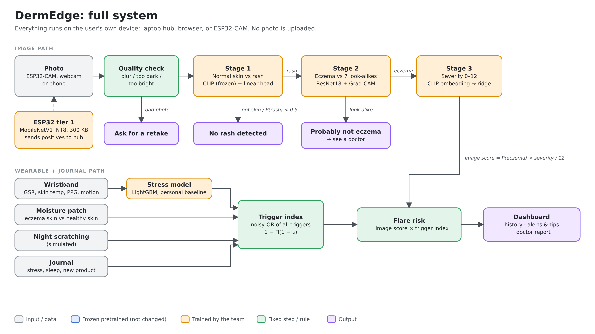
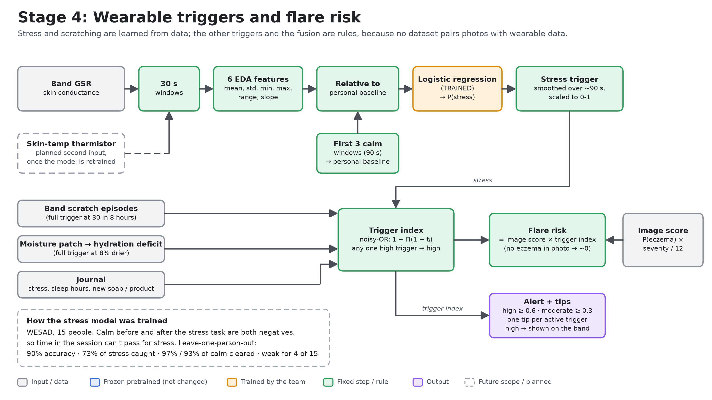
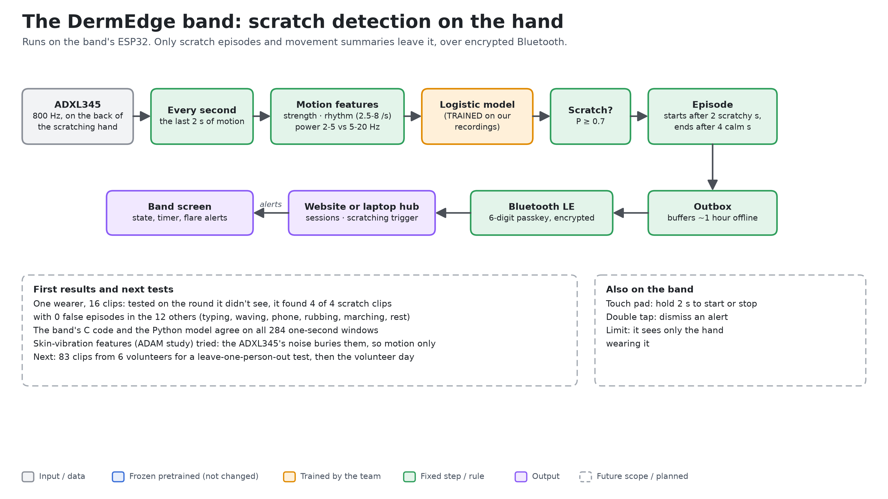

# DermEdge hardware and architecture plan

Where the hardware stands, which sensors are coming and on which pins, and how the pieces talk.
For building an app against it, see [DERMEDGE_APP_GUIDE.md](DERMEDGE_APP_GUIDE.md); for the
band's firmware, [firmware_dermedge/band/README.md](../firmware_dermedge/band/README.md). What the
wearable datasets show and how we augment and validate: [SENSOR_DATA.md](SENSOR_DATA.md).

## Decisions log

Newest first. Each decision is reflected in the sections below.

| Date | Decision | Why |
|---|---|---|
| 31 Oct 2026 | **ECG replaces GSR as the stress sensor; skin moisture is dropped.** The band's sensors are now the ADXL345 (scratching), ST7735 screen, capacitive touch pad, ECG (stress) and LM35 (skin temperature) on the ESP32 (Tishya). The stress model is retrained on WESAD's chest ECG (heart rate and HRV) with wrist temperature and motion. | Tishya's call. WESAD recorded chest ECG on the same 15 subjects, so the model can be retrained without new data. The pitch deck's GSR model figures no longer describe the band once this lands. |
| 31 Oct 2026 | **LM35, not the NTC thermistor** (reverses 25 Oct). Still one sensor, for the stress model. | Tishya's call. The LM35 is linear (10 mV/°C, no lookup) and needs only one pin. It runs on 5V; its output stays under 0.4 V at skin temperature, safe for the ADC. |
| 26 Oct 2026 | **The pitch deck is rebuilt around this plan** ([PITCH_DECK.md](PITCH_DECK.md)): phone or laptop camera, the DermEdge band, a future-scope slide. It quotes the band's GSR stress model (90% accuracy, 73% of stress caught), not the four-signal LightGBM's AUC 0.92-0.94. | The old deck still showed the ESP32-CAM and the Wi-Fi wristband. The LightGBM called 50% of WESAD's meditation and amusement windows stress, so its AUC overstates it (`scripts/train_gsr_stress.py`). |
| 25 Oct 2026 | **The website moves from pink to a teal theme** (accent `#0F7C74`), light on every device (it no longer follows the device's dark mode); pink and red are kept for alerts. The band's screen palette follows (Tishya). Tokens in `web/index.html`, listed in [DERMEDGE_APP_GUIDE.md](DERMEDGE_APP_GUIDE.md#design). | The skin photos are pink, so a pink interface hid them and made buttons look like alerts. Teal reads as clinical, contrasts with red rashes, and avoids a "skin-coloured" theme that implies light skin. |
| 25 Oct 2026 | **The scratch model uses motion features only, for now.** The band still samples at 800 Hz and computes the vibration features, for a better sensor later. | On the first recordings, the ADXL345's noise at 800 Hz (14-22 mg) buried the skin vibration: vibration features alone scored at chance on the held-out round and made the combined model worse. Motion alone found every scratch clip with no false episodes. |
| 25 Oct 2026 | **ESP32-CAM moves to future scope.** Photos for the finale come from the phone or laptop camera in the website and hub. The firmware and its 300 KB model stay in the repo. | Time before the finale goes to the band. |
| 25 Oct 2026 | **Skin temperature is a stress-model input only: one thermistor, not a lesion-vs-healthy pair.** The pair moves to future scope. | Most dermatologists we spoke to said skin temperature is too variable to be an eczema marker; one said lesions run warmer. In WESAD it drops under stress in 12 of 15 people, and the stress model uses it heavily (about 31% of its splits). |
| 25 Oct 2026 | **NTC thermistor, not LM35.** | Runs on 3V3 (the LM35 needs 5V), and moves ~33 mV/°C at skin temperature against the LM35's 10. The conversion code is in `archive/gsr_wristband_wifi/main/signals.c`. |
| 25 Oct 2026 | **Augment real data with our sensors' measured noise; don't synthesise paired data.** No generated stress or GSR for the Southampton patients. Each sensor model trains on its own dataset (late fusion). | Synthetic readings for real patients would be fabricated data, and a model would learn our assumptions back. Details in [SENSOR_DATA.md](SENSOR_DATA.md). |
| 25 Oct 2026 | **One-day volunteer pilot** with a friend with eczema, as a held-out test of the band's sensors on real eczema skin. Presented as an N = 1 feasibility pilot. | Only one day with the volunteer; that's enough to check the hardware, not to learn trigger→flare links. |

## 1. The system



A photo goes through three image stages; the wearable and the journal add **triggers**, combined
by a noisy-OR into a trigger index. Flare risk is the image score times the trigger index, so it
stays near zero without eczema in the photo. The Wearable tab shows trigger alerts on their own.



Both diagrams were redrawn on 26 Oct 2026 for the current plan (`scripts/draw_architecture.py`):
the band's scratch detector and GSR stress model, skin temperature as a planned stress input, and
the ESP32-CAM as future scope. They predate the 31 Oct switch from GSR to ECG and still show GSR. Scratch episodes feed the trigger "scratching (DermEdge band)", at
full strength at 30 episodes in 8 hours.



The other diagrams: [stage 1](architecture/1_stage1_clip_rash.png),
[stage 2](architecture/2_stage2_resnet_gradcam.png), [stage 3](architecture/3_stage3_severity.png),
[the ESP32-CAM on-device screen](architecture/5_esp32_on_device.png) (future scope, see §9).

## 2. How the band talks to everything

```
 add-on board on the back of the hand          ESP32 band (firmware_dermedge/band)
 ┌──────────────────────────────┐             ┌───────────────────────────────────────────────┐
 │ ADXL345 ── I2C 800 Hz ───────┼────────────►│ sensor task (10 ms) ─► detector task (1 s)    │
 │ touch pad OUT1 ──────────────┼────────────►│ state machine ◄── touch gestures               │
 └──────────────────────────────┘             │ ST7735 screen ◄── UI      outbox (1 h offline) │
                                              └──────────────┬────────────────────────────────┘
                                                             │ Bluetooth LE, passkey-paired, encrypted
                                                             ▼
                          website / app (web/js/band.js) ── /api/band/* ──► browser storage (website)
                                                                        └─► laptop hub, app/band.py (login)
```

- **Band:** records sessions started from its touch pad or the app, detects scratch episodes,
  and keeps about 20 hours of readings in its flash while disconnected (a 2.4 MB partition; they
  survive a restart; when it fills, new motion and sensor readings thin out before any scratch is lost).
- **Website (Vercel):** pairs with the band from the Home tab, relays its readings into recording
  sessions stored in the browser, feeds scratching into the flare risk, and sends high-risk
  alerts back to the band's screen (a double tap there dismisses them on both).
- **Hub (laptop):** the same `/api/band/*` API in SQLite, behind a login, for the laptop version.

## 3. Hardware in hand

| Part | Status | Notes |
|---|---|---|
| ESP32 DevKit (CP2102 USB) | working | Silicon Labs driver on macOS; upload on `/dev/cu.SLAB_USBtoUART` |
| 1.8" ST7735 TFT, red V1.1 board | working | VCC on **5V** (its regulator starves the panel on 3V3: white screen); RGB order (pink showed as lilac in BGR) |
| Add-on board: ADXL345 accelerometer | working, 800 Hz | CS to 3V3 (I2C mode) and SDO to GND (address 0x53), or it drops off the bus |
| Add-on board: 4-pad touch module (OUT1-OUT4) | OUT1 working | Hold 2 s: start/stop, tap: next view, double tap: dismiss. OUT2-4 could become real buttons if pins allow |
| LM35 temperature sensor | to wire | Skin temperature for the stress model. +Vs on **5V** (needs at least 4 V), output on GPIO 35 |
| ECG module (AD8232 assumed, to confirm) | to wire | Stress, from heart rate and HRV. Electrode placement still to decide (§5) |
| Add-on board: gesture and ultrasonic sensors | not used | The ultrasonic's echo is 5V: it needs a divider before any ESP32 pin |

**Where to wear it:** the add-on board on the **back of the hand** you scratch with, flat and
snug, the same way round every time. Scratch vibration is strongest there and fades by the wrist.

## 4. Pin map

| ESP32 pin | Used by | Why this pin |
|---|---|---|
| 23, 18 | TFT SDA, SCK | VSPI hardware SPI |
| 5 | TFT CS | |
| 16 | TFT A0 | not 2 (onboard LED), not 21 (I2C) |
| 4 | TFT RESET | |
| 21, 22 | I2C SDA, SCL: ADXL345 | the ESP32's default I2C pins |
| 27 | touch pad OUT1 | |
| 35 | **planned:** LM35 skin temperature | ADC1, input only |
| 36 (VP) | **planned:** ECG OUTPUT | ADC1, input only |
| 39 (VN), 34 | **planned:** ECG LO+, LO− (lead-off detect) | input only, digital |
| 33 | **planned:** ECG SDN (sleeps the module when not recording) | output |
| 32 | spare ADC1 (a second LM35 if the lesion-vs-healthy pair comes back) | ADC1 |
| 26, 25, 13 | spare: touch OUT2-4 if wanted | |

Rules behind it: analog sensors go on **ADC1** pins (32-39), because ADC2 stops working while
Bluetooth or Wi-Fi is on. Avoid the boot strapping pins (0, 2, 12, 15) for anything that could
pull them at reset. The old Wi-Fi wristband put moisture on GPIO 4 and 15; GPIO 4 is now the
TFT's RESET, so that plan (in `archive/gsr_wristband_wifi/HARDWARE_GUIDE.md`) no longer applies.

## 5. Sensors: what's coming

### ECG (stress)
Replaces GSR (31 Oct). The stress model is retrained on WESAD's chest ECG (700 Hz RespiBAN,
same 15 subjects): heart rate and HRV features with wrist temperature and motion, calibrated on
the wearer's first calm minutes as before. Compare it against the GSR model on the same
leave-one-subject-out split, so we know what dropping GSR costs.
- **Module:** AD8232 assumed (to confirm). OUTPUT to GPIO 36, LO+ / LO− to 39 / 34, SDN to 33,
  powered from 3V3.
- **Electrodes, still to decide:** ECG needs electrodes on opposite sides of the heart, so the
  band alone can't record it. Either sticky pads or a chest strap wired to the band (continuous,
  and where WESAD's ECG was recorded), or a 1-2 minute check with a finger of the other hand on a
  pad on top of the band (on demand, not continuous).
- **On the band:** R-peak detection and HR/HRV per window, sent over BLE; the raw trace stays on
  the band (about 250 Hz would swamp the link). Lead-off pins blank the reading when an
  electrode slips.
- **API:** new `ecg` / `hr` readings and a hub table; GSR and moisture go. Documented for the
  website and app before the firmware lands.

### Skin temperature: LM35 (with ECG, for the stress model)
**One** sensor, under the band and taped flat to the skin. It feeds the stress model only (skin
temperature drops slightly under stress); it is **not** an eczema or flare signal, as
dermatologists told us skin temperature is too variable for that.
- Flat side facing you, legs down: left (+Vs) to **5V**, middle (Vout) to **GPIO 35**, right to GND.
- 10 mV/°C, so skin (30-36 °C) gives 0.30-0.36 V. Read with 0 dB attenuation for the best
  resolution and average several reads per sample.
- The TO-92 package touches skin poorly and responds slowly: a dab of thermal paste or a small
  copper disc on the flat face helps. Keep it away from the ESP32's own heat and let it settle a
  minute. The model works on changes from the wearer's calm baseline, so absolute accuracy matters less.
- Known limit: WESAD was recorded indoors. Walking outside or into air conditioning also drops
  skin temperature, which the model could read as stress.
- API: the hub's `temperatures` field (`lesion_c`, `reference_c`) was designed for the pair; the
  stress model needs one skin temperature per sample in the same windows as the ECG.

### Dropped
- **GSR:** replaced by ECG (31 Oct).
- **Skin moisture:** dropped with GSR.
- **MAX30100 (PPG):** not needed; the ECG gives heart rate and HRV directly.

## 6. Scratch detection

**How it works:** the ADXL345 samples at 800 Hz. Every second the detector turns the last 2 s
of motion and 1 s of vibration into features (motion strength and rhythm at 2.5-8 strokes a
second, band powers from 2 to 400 Hz, and whether the 80-400 Hz vibration pulses in the stroke
rhythm), and a small logistic model trained on recordings scores them. Two scratchy seconds
start an episode; four calm ones end it.

The vibration features follow the ADAM sensor study (Chun et al., *Sci. Adv.* 7, eabf9405, 2021):
scratching makes a skin vibration that a 100 Hz smartwatch can't see, which is why one mistook
waving for scratching and missed finger-only scratching.

**First results (25 Oct 2026, one wearer, board on the back of the hand):** 16 clips of 20 s,
8 activities recorded twice with `tools/record.py session`; trained on one round, tested on the
other with `tools/tune.py`.

| | Scratch clips found | False episodes in the 12 other clips | Waving |
|---|---|---|---|
| Hand-set rule (before training) | 3 of 4 | 3 (waving twice, typing once) | flagged every second |
| Vibration features only | | | chance level (balanced accuracy 0.51) |
| **Motion features (on the band now)** | **4 of 4, one episode each** | **0** | **0%** |

- Vibration didn't help on this hardware: at 800 Hz the ADXL345's noise floor (14-22 mg RMS,
  flat across frequencies) hides it, and the vibration envelope never pulsed in the stroke rhythm
  (autocorrelation at most 0.30). ADAM used a low-noise sensor pressed to the skin.
- What separates scratching here is the motion pattern: where its energy sits (2-5 vs 5-20 Hz),
  its strength, and its rhythm. It partly learned that this wearer waves bigger than they
  scratch, so gentle waving may still fool it.
- The band's C code and the Python model agree on all 284 windows (largest probability
  difference 0.00006).
- The threshold (0.7) and episode ending (4 calm seconds) were picked on the same held-out round
  they were scored on, so these numbers are optimistic.

**Limits to keep in mind:** one wearer's recordings make a personal model, not a validated one.
ADAM tested on held-out people for that reason. Night-time is the easy case, with few lookalike
activities.

**Validation plan:**
1. All three of us record the `tools/record.py` session, so the model can be tested
   leave-one-person-out (train on two, test on the third), not only on a held-out round.
2. Augment the training recordings only: small axis rotations (the board sits at a slightly
   different angle), ±10% scaling, added noise at the ADXL345's measured level, and slight time
   stretching. Never augment the test data.
3. **Volunteer day:** the friend with eczema wears the band for one session (about 3 hours, plan
   in [SENSOR_DATA.md](SENSOR_DATA.md)). Their recording is never used for training; it's the
   final test on real eczema skin: "caught X of Y scratches".
4. Only scratches made by the hand wearing the band count; a band can't see the other hand.
   Record a few anyway and report them as a known limit.

## 7. Security and privacy

- **Bluetooth:** LE Secure Connections with a 6-digit passkey shown on the band, bonded; every
  characteristic needs that encrypted link, so others nearby (a school, a hospital) can't read
  the band or send it commands.
- **Website:** everything stays in the browser's own storage; "Delete all my data" removes the
  band's recordings too.
- **Hub:** logins (salted PBKDF2), hashed session and band tokens, every user's data separate.
  Still to do: the hub's older photo and journal endpoints have no login, and band-to-hub Wi-Fi
  would need HTTPS.
- **Not medical advice:** alerts are suggestions ("try a cool compress"), not instructions. Real
  clinical use would mean meeting health-data rules such as HIPAA.

## 8. Roadmap

1. Train and test the scratch model on recordings (in progress), then the volunteer day.
2. ECG (GPIO 36) and the LM35 (GPIO 35), with the stress model retrained on WESAD's chest ECG.
   Decide the electrode placement first.
3. The hub's own dashboard page: the same Home tab, band connection and camera fix as the website.
4. Off the breadboard: perfboard, then a PCB.

## 9. Future scope

Not part of the finale build; kept so the work isn't lost.
- **ESP32-CAM on-device screen** (`firmware_dermedge/esp32cam_screen/`): a 300 KB INT8 model
  that screens photos on the camera itself. It builds, but hasn't run on a board.
- **Lesion-vs-healthy temperature pair:** two LM35s (the second on GPIO 32), one on the lesion and one on healthy
  skin, with the difference as a flare signal. Revisit only with dermatologist support and
  data showing it tracks flares.
- **A second band** for the other hand, so scratching with either hand is seen.
